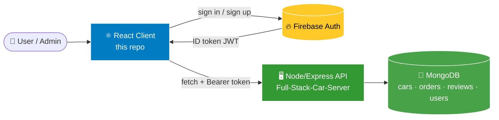
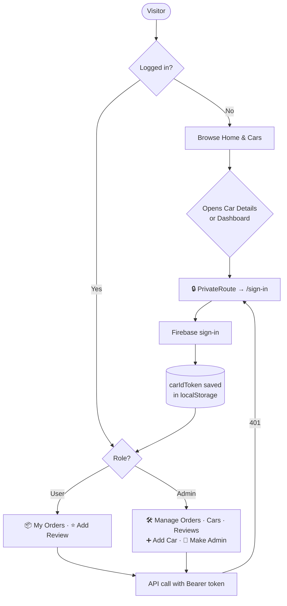
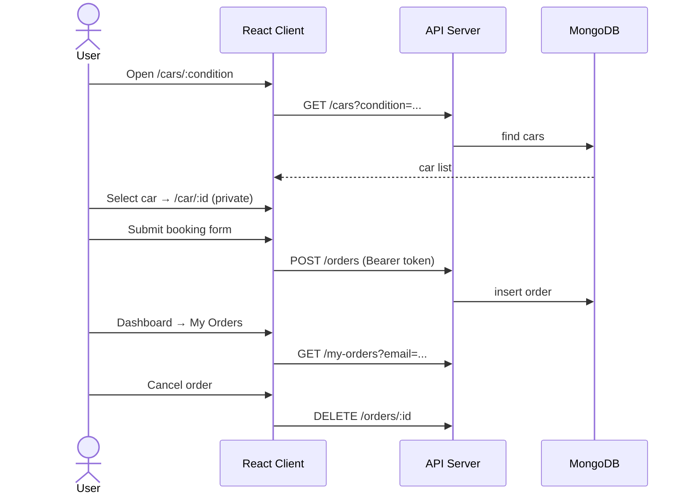

# Full-Stack-Car-Client<div align="center">


<a href="https://git.io/typing-svg"></a>

<br/>


<br/>

[](https://github.com/Syed-Muhammad-Tayyab/Full-Stack-Car-Client/stargazers)
[](https://github.com/Syed-Muhammad-Tayyab/Full-Stack-Car-Client/network/members)
[](https://github.com/Syed-Muhammad-Tayyab/Full-Stack-Car-Client/watchers)

### 🚀 [**Original Live App**](https://full-stack-car-app.web.app/) &nbsp;•&nbsp; 🖥️ [**Server Repo**](https://github.com/shadmansaalim/Full-Stack-Car-Server) &nbsp;•&nbsp; 🐞 [**Report Bug**](https://github.com/Syed-Muhammad-Tayyab/Full-Stack-Car-Client/issues/new?template=bug_report.md) &nbsp;•&nbsp; ✨ [**Request Feature**](https://github.com/Syed-Muhammad-Tayyab/Full-Stack-Car-Client/issues/new?template=feature_request.md)


</div>

## 📑 Table of Contents

<details open>
<summary><b>Click to expand / collapse</b></summary>

1. [✨ About the Project](#-about-the-project)
2. [🎯 Key Features](#-key-features)
3. [🖼️ Screenshots & Gallery](#️-screenshots--gallery)
4. [🧰 Tech Stack](#-tech-stack)
5. [🏗️ Architecture & Flows](#️-architecture--flows)
6. [📂 Repository Structure](#-repository-structure)
7. [🧭 Routes & Pages](#-routes--pages)
8. [🔌 API Endpoints Used](#-api-endpoints-used)
9. [⚙️ How It Works](#️-how-it-works)
10. [🚀 Getting Started](#-getting-started)
11. [☁️ Deployment](#️-deployment)
12. [🛣️ Roadmap](#️-roadmap)
13. [❓ FAQ](#-faq)
14. [🤝 Contributing](#-contributing)
15. [📜 License & Credits](#-license--credits)
16. [👨‍💻 Developer](#-developer)

</details>


## ✨ About the Project

> **Full-Stack Car Client** is the **React front-end** of a niche full-stack car marketplace. Visitors browse **new and used cars**, sign in with **Firebase Authentication**, **book a car**, track their orders, and leave reviews that appear on the home-page slider. Behind the scenes, a role-based **Admin Panel** lets admins manage orders, cars, reviews, and other admins.

The client talks to a separate **Node.js + Express + MongoDB** server and secures requests with a **Firebase ID token (JWT)** plus **private routes** — a double layer of protection for restricted pages.

<table>
<tr>
<td align="center" width="25%">🚘<br/><b>Browse</b><br/><sub>New · Used · Filter by brand, model & type</sub></td>
<td align="center" width="25%">🛒<br/><b>Book</b><br/><sub>Order a car, view it in My Orders, cancel anytime</sub></td>
<td align="center" width="25%">⭐<br/><b>Review</b><br/><sub>Star ratings shown on the landing slider</sub></td>
<td align="center" width="25%">🛠️<br/><b>Administer</b><br/><sub>Orders · Cars · Reviews · Admins</sub></td>
</tr>
</table>


## 🎯 Key Features

| # | Feature | Description |
|:-:|---------|-------------|
| 🏠 | **Landing Page** | Home banner, **New Cars**, **Used Cars**, and a **Sell Your Car / Trade-in** section, followed by a **customer reviews slider** (`react-slick`). |
| 🚘 | **Cars Catalogue** | `/cars/:condition` lists cars filtered by condition with **brand logos**, **body-type** and **model** filters plus **pagination** (`react-paginate`). |
| 📄 | **Car Details** | Full overview, features, and availability for each car, with a booking flow (login required). |
| 🔐 | **Authentication** | **Sign Up / Sign In** with Email & Password, plus **Google**, **Facebook** and **Twitter** providers through Firebase. |
| 🛡️ | **Private Routes** | `/car/:id` and `/dashboard` are guarded by `PrivateRoute`; admin pages by `AdminRoute`. |
| 🔑 | **JWT-secured API** | Firebase ID token stored as `carIdToken` and sent as a `Bearer` header; `401` responses redirect to sign-in. |
| 📦 | **My Orders** | Users see their bookings and can **cancel** them (synced with the database). |
| ⭐ | **Add Review** | Users rate with `react-rating`; reviews appear on the home slider. |
| 🧑‍💼 | **Admin Dashboard** | A completely different dashboard layout for admins: **Manage Orders, Manage Reviews, Manage Cars, Add New Car, Make Admin**. |
| 🔔 | **Great UX** | Toasts (`react-toastify`), alerts (`sweetalert`), loading spinners, scroll-to-top on route change. |
| 📱 | **Fully Responsive** | Bootstrap grid + off-canvas sidebar toggle on the dashboard. |
| ☁️ | **Firebase Hosting Ready** | `firebase.json` rewrites + `_redirects` for SPA routing. |


## 🖼️ Screenshots & Gallery

> The images below are real assets from [`/src/images`](./src/images). Add your own app screenshots to `docs/screens/` and link them here.

### 🏷️ Brand Logos (used in the Cars filter)

<div align="center">

| | | | | |
|:---:|:---:|:---:|:---:|:---:|
|  |  |  |  |  |
|  |  |  |  |  |

</div>

### 🚗 Body Types

<div align="center">

| | | | | | |
|:---:|:---:|:---:|:---:|:---:|:---:|
|  |  |  |  |  |  |
|  |  |  |  |  |  |

</div>

### 🔑 Social Sign-in Icons

<div align="center">

 &nbsp;&nbsp;  &nbsp;&nbsp;  &nbsp;&nbsp; 

</div>


## 🧰 Tech Stack

<div align="center">


</div>

| Layer | Technology | Purpose |
|-------|-----------|---------|
| ⚛️ UI Library | **React 17** (Create React App 4) | Component-based SPA |
| 🧭 Routing | **react-router-dom 5.3** | Pages, nested dashboard routes, private/admin routes |
| 🎨 Styling | **Bootstrap 5.1**, **React-Bootstrap 2**, **Bootstrap Icons**, custom CSS | Responsive layout & components |
| 🔣 Icons | **FontAwesome** (`@fortawesome/*`) | Dashboard & UI icons |
| 🔐 Auth | **Firebase 9** | Email/password + social sign-in, ID tokens |
| 📝 Forms | **react-hook-form 7** | Sign-up, add-car, add-review, orders |
| 🎠 Carousel | **react-slick** + **slick-carousel** | Reviews slider |
| ⭐ Rating | **react-rating** | Star reviews |
| 📄 Pagination | **react-paginate** | Cars listing |
| 🔔 Feedback | **react-toastify**, **sweetalert** | Toasts & alert dialogs |
| 🗄️ Backend (separate repo) | **Node.js, Express, MongoDB** | REST API, orders, cars, reviews, admin roles |
| 🚀 Hosting | **Firebase Hosting** | SPA rewrites configured |


## 🏗️ Architecture & Flows

### 🧱 System Architecture



### 🔐 Authentication & Access Flow



### 🛒 Booking Flow




## 📂 Repository Structure

```text
📦 Full-Stack-Car-Client
│
├── 📄 package.json                 # 📦 Dependencies & scripts (CRA)
├── 📄 .env.example                 # 🔑 Firebase env template (copy → .env.local)
├── 📄 firebase.json                # ☁️ Hosting config (SPA rewrites)
├── 📄 .firebaserc                  # 🔥 Firebase project alias
├── 📄 README.md                    # 📖 You are here
├── 📄 CONTRIBUTING.md              # 🤝 Contribution guide
├── 📄 CODE_OF_CONDUCT.md           # 💛 Community rules
├── 📄 .gitignore · .editorconfig
│
├── 📁 public/
│   ├── 📄 index.html · manifest.json · robots.txt
│   ├── 📄 _redirects               # 🔁 SPA fallback (Netlify)
│   └── 🖼️ favicon.ico · logo192.png · logo512.png
│
├── 📁 src/
│   ├── 📄 index.js · App.js · App.css · index.css
│   │
│   ├── 📁 Firebase/                # 🔥 firebase.config.js · firebase.init.js
│   ├── 📁 hooks/                   # 🪝 useFirebase.js · useAuth.js
│   ├── 📁 context/                 # 🌐 ContextProvider.js (auth context)
│   ├── 📁 ScrollToTop/             # ⬆️ Scroll reset on navigation
│   ├── 📁 images/                  # 🖼️ Brand logos, body types, social icons
│   │
│   └── 📁 Pages/
│       ├── 📁 Home/                # 🏠 Home · HomeBanner · NewCars · UsedCars · SellCar · Reviews
│       ├── 📁 Cars/                # 🚘 Cars · CarBrand · CarModel · CarType
│       ├── 📁 CarDetails/          # 📄 Single car + booking
│       ├── 📁 SignIn/ · 📁 Join/   # 🔐 Login & registration
│       ├── 📁 PrivateRoute/        # 🛡️ Auth guard
│       ├── 📁 AdminRoute/          # 👑 Admin-only guard
│       ├── 📁 Shared/              # 🧩 Navigation · Footer · Car card
│       └── 📁 Dashboard/
│           ├── 📁 Dashboard/       # 🧭 Sidebar layout + nested routes
│           ├── 📁 DashboardHome/   # 📊 Overview
│           ├── 📁 MyOrders/        # 📦 User orders
│           ├── 📁 AddReview/       # ⭐ User review form
│           ├── 📁 ManageAllOrders/ # 🧾 Admin: all orders
│           ├── 📁 ManageCars/      # 🚘 Admin: delete cars
│           ├── 📁 AddCar/          # ➕ Admin: add car
│           ├── 📁 ManageReviews/   # ✍️ Admin: reviews
│           └── 📁 MakeAdmin/       # 👑 Admin: promote users
│
├── 📁 docs/assets/                 # 🖼️ README banner & divider (SVG)
│
└── 📁 .github/
    ├── 📁 ISSUE_TEMPLATE/          # 🐞 Bug · ✨ Feature
    ├── 📄 pull_request_template.md
    └── 📁 workflows/ci.yml         # ✅ Build check on push / PR
```

### 📊 Project at a Glance

| 📄 Page Components | 🧩 Shared Components | 🪝 Custom Hooks | 🖼️ Images | 📏 JS + CSS Lines |
|:---:|:---:|:---:|:---:|:---:|
| **30** | **3** | **2** | **28** | **~3,800** |


## 🧭 Routes & Pages

| Route | Page | Access |
|-------|------|:------:|
| `/` · `/home` | Landing page (banner, new/used cars, sell, reviews) | 🌍 Public |
| `/cars/:condition` | Cars catalogue with filters & pagination | 🌍 Public |
| `/sign-in` | Sign in | 🌍 Public |
| `/join` | Create account | 🌍 Public |
| `/car/:id` | Car details & booking | 🔒 Logged in |
| `/dashboard` | Dashboard home | 🔒 Logged in |
| `/dashboard/my-orders` | My orders (cancel) | 👤 User |
| `/dashboard/add-review` | Add a review | 👤 User |
| `/dashboard/manage-orders` | All orders | 👑 Admin |
| `/dashboard/manage-reviews` | Manage reviews | 👑 Admin |
| `/dashboard/manage-cars` | Manage cars | 👑 Admin |
| `/dashboard/add-car` | Add new car | 👑 Admin |
| `/dashboard/make-admin` | Promote a user to admin | 👑 Admin |


## 🔌 API Endpoints Used

The client calls the REST API of [**Full-Stack-Car-Server**](https://github.com/shadmansaalim/Full-Stack-Car-Server). Endpoints found in the source:

| Method | Endpoint | Purpose |
|:------:|----------|---------|
| `GET` | `/cars` · `/cars?condition=` | List cars (optionally by condition) |
| `GET` | `/car/:id` | Single car |
| `POST` | `/add-car` | Add a new car *(admin)* |
| `DELETE` | `/cars/:id` | Remove a car *(admin)* |
| `POST` | `/orders` | Place an order |
| `GET` | `/my-orders?email=` | Orders of the logged-in user |
| `GET` | `/allOrders?email=` | All orders *(admin)* |
| `PUT` | `/ordersUpdate/:id` | Update order status *(admin)* |
| `DELETE` | `/orders/:id` | Cancel / remove an order |
| `GET` · `POST` | `/reviews` | List / add reviews |
| `DELETE` | `/reviews/:id` | Remove a review *(admin)* |
| `POST` · `PUT` | `/users` · `/users/admin` | Save user / make admin |
| `GET` | `/users/:email` | Check admin role |
| `GET` | `/dashboard-data?email=` | Dashboard statistics |

> ⚠️ HTTP verbs for some routes depend on the server implementation — check the server repo for the exact contract.


## ⚙️ How It Works

<details>
<summary><b>🔥 Firebase authentication (<code>useFirebase.js</code>)</b></summary>
<br/>

The hook initialises Firebase from environment variables, exposes `registerUser`, `loginUser`, `signInWithGoogle`, `signInWithFacebook`, `signInWithTwitter`, `logOut` and keeps the current `user` in sync via `onAuthStateChanged`. On every login it calls `getIdToken(user)` and stores it as `carIdToken` in `localStorage`.

```js
// firebase.config.js — values come from your .env.local
const firebaseConfig = {
  apiKey: process.env.REACT_APP_API_KEY,
  authDomain: process.env.REACT_APP_AUTH_DOMAIN,
  projectId: process.env.REACT_APP_PROJECT_ID,
  storageBucket: process.env.REACT_APP_STORAGE_BUCKET,
  messagingSenderId: process.env.REACT_APP_MESSAGING_SENDER_ID,
  appId: process.env.REACT_APP_APP_ID,
};
```

</details>

<details>
<summary><b>🛡️ Private & admin routes</b></summary>
<br/>

`PrivateRoute` redirects unauthenticated visitors to `/sign-in`; `AdminRoute` additionally checks the `admin` flag from `useAuth()`. The dashboard sidebar renders a **different menu** for admins and users.

</details>

<details>
<summary><b>🔑 Secured API calls</b></summary>
<br/>

```js
fetch(`${API}/dashboard-data?email=${user.email}`, {
  headers: { authorization: `Bearer ${localStorage.getItem("carIdToken")}` },
})
  .then(res => res.status === 401 ? history.push("/sign-in") : res.json());
```

</details>

<details>
<summary><b>🚘 Cars filtering</b></summary>
<br/>

`Cars.js` fetches by condition, derives the unique **brands** and **models** from the result, and lets users narrow by brand logo, model, and body type, with `react-paginate` handling pages.

</details>

<details>
<summary><b>🧑‍💼 Admin dashboard</b></summary>
<br/>

Admins can promote users (**Make Admin**), update or remove any order, add or delete cars, and moderate reviews. Regular users only see **My Orders** and **Add Review**. The sidebar collapses into an off-canvas menu on small screens.

</details>


## 🚀 Getting Started

### ✅ Prerequisites

- **Node.js 14 or 16** (Create React App 4 — on Node 17+ run with `NODE_OPTIONS=--openssl-legacy-provider`)
- **npm**
- A **Firebase project** with Authentication enabled (Email/Password + any social providers you want)
- A running instance of the **[server](https://github.com/shadmansaalim/Full-Stack-Car-Server)**

### 📥 Installation

```bash
# 1️⃣ Clone the repository
git clone https://github.com/Syed-Muhammad-Tayyab/Full-Stack-Car-Client.git
cd Full-Stack-Car-Client

# 2️⃣ Install dependencies
npm install

# 3️⃣ Add your Firebase keys
cp .env.example .env.local        # then edit .env.local

# 4️⃣ Start the dev server
npm start                         # → http://localhost:3000
```

### 🔑 Environment Variables

| Variable | Description |
|----------|-------------|
| `REACT_APP_API_KEY` | Firebase API key |
| `REACT_APP_AUTH_DOMAIN` | `your-project.firebaseapp.com` |
| `REACT_APP_PROJECT_ID` | Firebase project ID |
| `REACT_APP_STORAGE_BUCKET` | Storage bucket |
| `REACT_APP_MESSAGING_SENDER_ID` | Messaging sender ID |
| `REACT_APP_APP_ID` | Firebase app ID |

### 📜 Available Scripts

| Command | What it does |
|---------|--------------|
| `npm start` | Run in development mode |
| `npm run build` | Production build into `/build` |
| `npm test` | Run the test runner |

> ⚠️ **API base URL:** the source currently calls a hard-coded hosted API (`pure-sands-37131.herokuapp.com`). Heroku's free tier has been discontinued, so that host may be offline. Deploy your own copy of the server and replace the URL (see [Roadmap](#️-roadmap)).

> 👑 **Becoming an admin:** after registering, set your user's role to `admin` in the database (or have an existing admin use **Make Admin**).


## ☁️ Deployment

### 🔥 Firebase Hosting (preconfigured)

```bash
npm run build
npm install -g firebase-tools
firebase login
firebase deploy --only hosting
```

`firebase.json` already serves `build/` and rewrites every path to `/index.html`.

### 🌐 Netlify / Vercel / Cloudflare Pages

Build command `npm run build`, output directory `build`. The `public/_redirects` file already handles SPA routing on Netlify.


## 🛣️ Roadmap

- [x] 🏠 Landing page with new/used cars and reviews slider
- [x] 🚘 Cars catalogue with brand / model / type filters and pagination
- [x] 🔐 Firebase auth (Email, Google, Facebook, Twitter)
- [x] 🛡️ Private & admin routes with JWT-secured API
- [x] 📦 Order booking, My Orders, cancel order
- [x] 🧑‍💼 Admin dashboard (orders, cars, reviews, make admin)
- [ ] 🔧 Move the API base URL into `REACT_APP_API_URL`
- [ ] 🖥️ Redeploy the server on a currently supported host
- [ ] ⬆️ Upgrade to React 18, React Router 6 and Firebase modular v10
- [ ] 💳 Online payment integration
- [ ] ❤️ Wishlist & car comparison
- [ ] 🌍 Multi-language support
- [ ] ♿ Accessibility audit

> Have an idea? [Open a feature request](https://github.com/Syed-Muhammad-Tayyab/Full-Stack-Car-Client/issues/new?template=feature_request.md) 💡


## ❓ FAQ

<details>
<summary><b>Why does the app show no cars / fails to load data?</b></summary>
<br/>The client depends on a running API. The hard-coded Heroku URL may be offline — deploy the server and update the base URL.
</details>

<details>
<summary><b>Firebase says "invalid API key".</b></summary>
<br/>Create <code>.env.local</code> from <code>.env.example</code>, fill in your own Firebase values, and restart <code>npm start</code>.
</details>

<details>
<summary><b>How do I get access to the admin panel?</b></summary>
<br/>Mark your user as admin in the database, or ask an existing admin to use <b>Make Admin</b>.
</details>

<details>
<summary><b>Is it safe to commit the Firebase config?</b></summary>
<br/>Firebase web keys are not secret by themselves, but this repo keeps them in <code>.env.local</code> (git-ignored) and you should restrict them in the Firebase console.
</details>


## 🤝 Contributing

Contributions make the open-source world amazing! 💛

```bash
git checkout -b feature/amazing-feature
git commit -m "feat: add amazing feature"
git push origin feature/amazing-feature
```

Then open a **Pull Request**. Please read [CONTRIBUTING.md](./CONTRIBUTING.md) and the [Code of Conduct](./CODE_OF_CONDUCT.md) first.

## 📜 License & Credits

> 📌 The source this repo is based on did **not include a license file**. Before reusing or redistributing the code, check with the original author and add a `LICENSE` that matches their permission.

| Credit | Link |
|--------|------|
| 🧱 Original project & concept | [Saalim Shadman — Full-Stack-Car-Server / Client](https://github.com/shadmansaalim/Full-Stack-Car-Server) |
| ⚛️ React & CRA | [reactjs.org](https://reactjs.org/) |
| 🔥 Firebase | [firebase.google.com](https://firebase.google.com/) |
| 🎨 Bootstrap & React-Bootstrap | [react-bootstrap.github.io](https://react-bootstrap.github.io/) |
| 🎨 README badges | [Shields.io](https://shields.io/) · [Capsule Render](https://github.com/kyechan99/capsule-render) · [Typing SVG](https://github.com/DenverCoder1/readme-typing-svg) · [Skill Icons](https://skillicons.dev/) |


## 👨‍💻 Developer

<div align="center">

<a href="https://github.com/Syed-Muhammad-Tayyab">
  
</a>

### **Syed Muhammad Tayyab**

*BSCS Student · Information Security · Full-Stack Web Developer*

[](https://github.com/Syed-Muhammad-Tayyab)

<br/>


<br/>

### ⭐ If you like this project, give it a star — it keeps me building! ⭐


**Developed with ❤️ by Syed Muhammad Tayyab**

</div>
